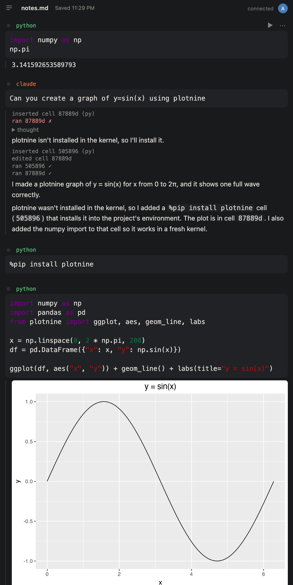

# yupyter

A zen-mode notebook on Jupyter kernels. Markdown files, multiple kernels, live multiplayer, and Claude as a kernel.

<p align="center"></p>

Above, a `claude` cell asks for a plot. Claude reads the notebook, inserts a cell and runs it. When that fails
because plotnine is missing, it adds a `%pip install` cell, runs both, and explains what it did. Its trace
(tool calls in grey, a failed run in red, thinking folded away) stays in the notebook, and everything it did
can be undone in one click.

## Why it's nice

- **Notebooks are plain Markdown.** No `.ipynb` JSON: the file reads like a document, diffs cleanly in git, and
  you (or Claude Code, or vim) can edit it while it's open. Changes on disk show up live. Images go in a
  sibling `notes.assets/` folder. Here's the top of [examples/notes.md](examples/notes.md), the notebook in
  the screenshot:

  ````markdown
  ```py {#d07397}
  import numpy as np
  np.pi
  ```

  ```output {for=d07397 type=result}
  3.141592653589793
  ```

  ```claude {#bc8734}
  Can you create a graph of y=sin(x) using plotnine
  ```
  ````

- **Claude is a kernel, not a sidebar.** A `claude` (or `%%claude`) cell runs like any other cell. Claude sees
  the whole notebook, its outputs and the installed kernels, and works in the notebook itself: it inserts,
  edits and runs cells you can read, rerun or change. Each run is one undo step.
- **Live multiplayer.** Share the URL and edit together, with avatars, remote cursors and per-user undo
  (built on Yjs CRDTs).
- **Any Jupyter kernel, mixed in one file.** Python, R, Julia... each cell picks its kernel, and each notebook
  gets its own kernel processes.
- **Quiet UI.** One centred column, no toolbars. Commands live in the palette (Ctrl/Cmd+K); a file drawer and
  save status sit in the corner.

## Quickstart

Needs Python 3.10+ and Node 18+ (to build the frontend).

```bash
git clone https://github.com/wrongbad/yupyter
cd yupyter
python3 -m venv .venv && . .venv/bin/activate
pip install -e .
cd examples && yupyter
```

`yupyter notes.md` serves the current directory and opens `notes.md`; `yupyter some/dir` (or just `yupyter`)
serves that directory and shows the file drawer, where you can open any notebook under it or create one.
The server never reaches outside that root. One kernel per notebook; files edited on disk while open are
picked up (or flagged if you have unsaved changes).

Then click "+ New cell", type, and press Shift+Enter:

```
2 + 2
%%claude please graph y = 2 + x
```

`%%claude` uses your Claude Code login (run `claude` once) or `ANTHROPIC_API_KEY`.

Development: see [CONTRIBUTING.md](CONTRIBUTING.md).
