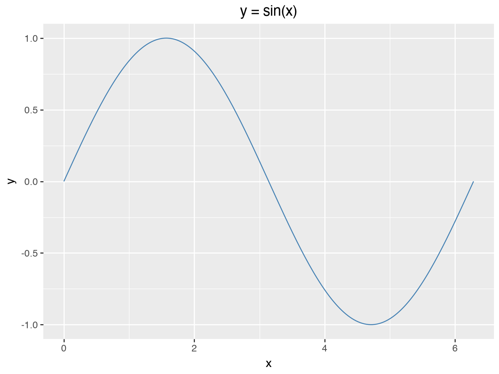
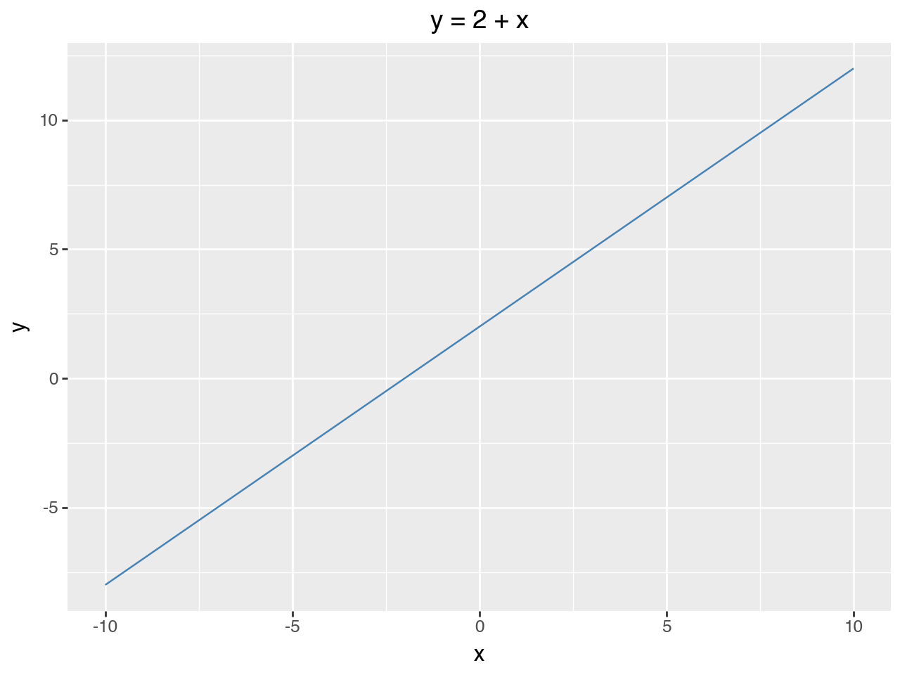

```py {#d07397 author=rwrppt}
2+2
```

```output {for=d07397 type=result}
4
```

```claude {#bc8734 author=rwrppt}
Can you create a graph of y=sin(x) using plotnine
```

```output {for=bc8734 type=display}
- inserted cell deff43 (python3)
- ran deff43 ✓
I added cell `deff43`, which plots y = sin(x) from 0 to 2π with plotnine. It ran and shows one full sine wave inline.
```

```py {#21732f author=claude run=2b0e278a}
import numpy as np
import pandas as pd
from plotnine import ggplot, aes, geom_line, labs

x = np.linspace(0, 2 * np.pi, 200)
df = pd.DataFrame({"x": x, "y": np.sin(x)})

(ggplot(df, aes("x", "y")) + geom_line(color="steelblue") + labs(title="y = sin(x)"))
```

<!-- yupyter:output for=21732f mime=image/png -->


```py {#94953a author=claude run=c4476722}
%pip install -q plotnine
```

```output {for=94953a}
Note: you may need to restart the kernel to use updated packages.
```

```py {#191f44 author=claude run=c4476722}
import numpy as np
import pandas as pd
from plotnine import ggplot, aes, geom_line, labs

df = pd.DataFrame({"x": np.linspace(-10, 10, 100)})
df["y"] = 2 + df["x"]

ggplot(df, aes("x", "y")) + geom_line(color="steelblue") + labs(title="y = 2 + x")
```

<!-- yupyter:output for=191f44 mime=image/png -->

