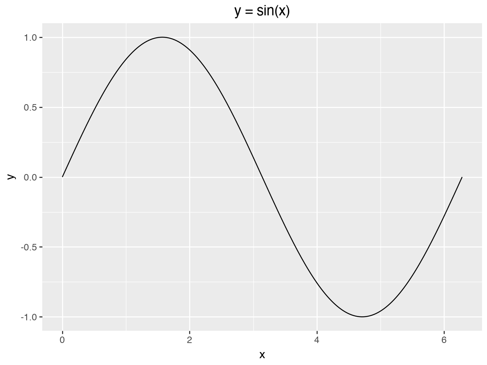

```py {#d07397 author=rwrppt}
import numpy as np
np.pi
```

```output {for=d07397 type=result}
3.141592653589793
```

```claude {#bc8734 author=rwrppt}
Can you create a graph of y=sin(x) using plotnine
```

```output {for=bc8734 type=agent}
- inserted cell 87889d (py)
! ran 87889d ✗
[thinking] I need to install plotnine via pip since it's not available yet. Since the kernel appears fresh (In[1]), I should also add the numpy import to be safe.


[answer] plotnine isn't installed in the kernel, so I'll install it.
- inserted cell 505896 (py)
- edited cell 87889d
- ran 505896 ✓
- ran 87889d ✓
[answer] I made a plotnine graph of y = sin(x) for x from 0 to 2π, and it shows one full wave correctly.

  plotnine wasn't installed in the kernel, so I added a `%pip install plotnine` cell (`505896`) that installs it into the project's environment. The plot is in cell `87889d`. I also added the numpy import to that cell so it works in a fresh kernel.
```

```py {#505896 author=claude run=cb3960f30bb0}
%pip install plotnine
```

```py {#87889d author=claude run=cb3960f30bb0}
import numpy as np
import pandas as pd
from plotnine import ggplot, aes, geom_line, labs

x = np.linspace(0, 2 * np.pi, 200)
df = pd.DataFrame({"x": x, "y": np.sin(x)})

ggplot(df, aes("x", "y")) + geom_line() + labs(title="y = sin(x)")
```

<!-- yupyter:output for=87889d mime=image/png -->

